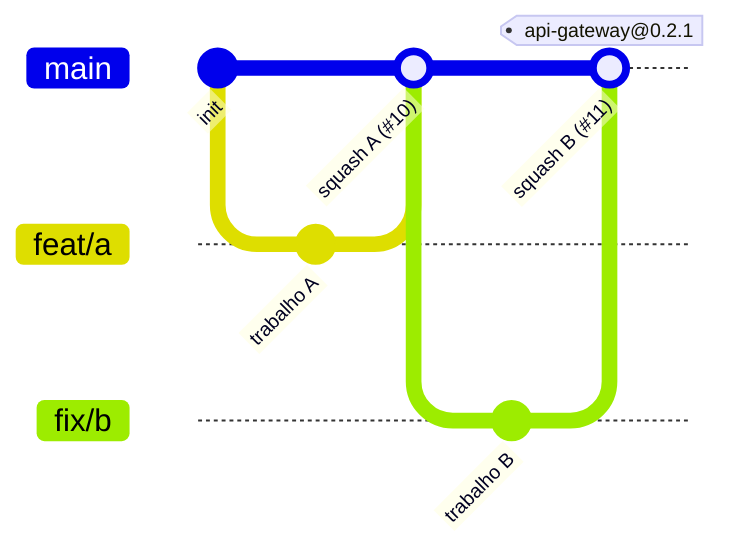

# Estratégia de branches

Decisão: [kb/decisoes/0028](kb/decisoes/0028-trunk-based-e-release-por-app.md) (trunk-based com
release por app). O passo a passo do dia a dia está no [CONTRIBUTING.md](../CONTRIBUTING.md),
seção 4; este documento explica o modelo e por que cada gate existe.

## O modelo

- **`main`**: a **única** branch protegida. É dela que sai toda branch de trabalho, e é para ela
  que volta todo PR. Ninguém dá push direto nela: o ruleset do GitHub recusa no servidor e o hook
  local (`no-commit-to-protected-branch`) recusa antes de sair da máquina.
- **Branches de trabalho** saem da `main` e voltam por PR para a `main`: `feat/<nome>`,
  `fix/<nome>`, `chore/<nome>`, `docs/<nome>`. Com issue, o nome leva o número:
  `feat/123-cupom-no-carrinho`.
- **PR pequeno.** É a proteção principal do modelo: o que passa pelo CI cai direto na base de todo
  mundo. Trabalho incompleto entra na `main` desligado no app, ou atrás de configuração.
- **Merge só por squash**, com histórico linear. O título do PR vira a mensagem do commit na `main`
  (Conventional Commits, com `(#NN)` no fim).
- **Release é tag por app** (`<app>@<versão>`, ex.: `api-gateway@0.2.0`), criada só pelo workflow
  de release. Homologação e produção são promoção da mesma imagem.

```bash
git fetch origin
git switch -c feat/<slug> origin/main
```

Note o `origin/main`, não a `main` local, que pode estar velha. Nada de
`git switch main && git pull` antes: manter cópia local de branch protegida só cria a pergunta "a
minha está atualizada?", e é assim que alguém acaba commitando nela por engano.

Com issue aberta, o GitHub cria a branch já ligada a ela:

```bash
gh issue develop 123 --name feat/123-cupom-no-carrinho --base main
```

### O dia a dia

```text
1. Issue no projeto      com as labels de produto, unidade e tipo
2. Branch                saindo da origin/main
3. PR em draft           o CI roda; o botão de merge fica travado
4. Ready for review      o CODEOWNERS pede a revisão dos donos
5. Squash merge          "feat(cart): ... (#140)" com "Closes #123"
6. Release               tag <app>@<versão> pelo workflow de release
```



### O draft PR é a pista livre

Para descobrir se o CI quebra antes de pedir revisão, abra o PR em **draft** (pela setinha do botão:
*"Create draft pull request"*). O CI roda igual, o botão de merge fica travado e ninguém é chamado
para revisar. Quando ficar verde, **"Ready for review"**.

A branch que você testou é a mesma que vai ser mergeada (não existe "testei numa, subo outra") e
cada pessoa tem a sua, sem disputar.

> **O CI roda só pelo evento `pull_request`.** É o que se quer: o GitHub testa o **resultado do
> merge** com a `main`, não a sua branch sozinha. Ter também `push` na `main` faria o CI rodar duas
> vezes sobre o mesmo código.

### O que mudou em relação ao fluxo antigo

Até a [ADR-0028](kb/decisoes/0028-trunk-based-e-release-por-app.md), o guia de desenvolvimento
mandava criar a branch a partir de uma `develop`, e o `ci.yml` rodava em `pull_request` e em `push`
na `main` e na `develop`. Agora:

- não existe `develop`: nenhuma branch sai dela e nenhum PR vai para ela;
- o CI escuta só `pull_request` para a `main` (e o botão *Run workflow*);
- o push direto na `main` deixa de ser possível quando o ruleset for aplicado.

Se uma branch `develop` existir no remoto, um dono a arquiva antes de apagar:

```bash
git fetch origin
git rev-list --count origin/main..origin/develop     # tem que dar 0; senão, decida antes o que fazer
git push origin "origin/develop:refs/heads/arquivo/develop-$(date +%Y-%m-%d)"
git push origin --delete develop
```

### Onde o CI roda

| Evento | Workflow | O que roda |
|---|---|---|
| PR para a `main` (inclusive **draft**), a cada push na branch do PR | `ci.yml` | todos os jobs, agregados no `CI OK`, sobre o **resultado do merge** com a `main` |
| Botão *Run workflow* na aba Actions (`workflow_dispatch`) | `ci.yml` | o mesmo CI, sobre a branch escolhida, sem PR |
| Merge na `main` que muda `.releases/*.json` | `release.yml` | confere o BOM, cria a tag e o GitHub Release e monta a imagem |
| Push numa branch de trabalho **sem PR** | nenhum | nada roda: abra o PR em draft |

Não existe CI em `push` na `main`, de propósito: o commit que entra nela já foi testado no PR, como
resultado do merge. **O draft PR é o lugar de "ver se o CI passa"**.

## Checklist para repositório novo

É também o que falta fazer **neste** repositório para as regras valerem no servidor (CONTRIBUTING,
seção 13).

1. Confirme que a `main` é a branch padrão:
   `gh repo view --json defaultBranchRef --jq .defaultBranchRef.name`.
2. Rode `scripts/setup-rulesets.sh` (exige [GitHub CLI](https://cli.github.com/) instalada e
   autenticada com conta admin: `gh auth login`). Sem argumento, ele só **mostra** o que faria. Com
   `--apply`, ele:
   - deixa o repositório só com squash merge e apaga a branch depois do merge;
   - cria o ruleset **`main`**: exige PR e o check `CI OK`, revisão de CODEOWNERS, descarta
     aprovação quando entra push novo, exige aprovação do último push, só squash, histórico linear,
     sem force-push e sem deleção;
   - cria o ruleset **`tags-de-release`** (`*@*`): só o GitHub Actions cria, move ou apaga essas
     tags.

   É seguro rodar de novo: cada ruleset é procurado pelo nome e atualizado se já existir.
3. Confira os donos em [`.github/CODEOWNERS`](../.github/CODEOWNERS): ver
   [Revisão de PR: CODEOWNERS](#revisão-de-pr-codeowners) abaixo. A conferência que não depende
   de abrir PR: `gh api "repos/<dono>/<repo>/codeowners/errors?ref=<branch>"` tem que voltar com a
   lista `errors` vazia. Dono sem permissão de escrita aparece ali como "Unknown owner".
4. Confira que o script ligou o *secret scanning* e o *push protection* (*Settings -> Code
   security*). Se a conta não permitir pela API, o script avisa, e eles se ligam ali, à mão.
5. Crie as labels que os modelos de issue usam: `tipo:feat`, `tipo:fix`, `tipo:chore`, `tipo:docs`,
   `produto:ecommerce` e uma `unidade:<id>` por unidade.
6. Abra um PR de teste para a `main` e confira: o `CI OK` aparece como obrigatório e a revisão dos
   donos é pedida sozinha.

> Diferente da proteção clássica, o ruleset aceita o nome do check antes de ele existir. Não é
> preciso esperar o primeiro PR rodar para marcar o `CI OK`.

## O check agregado e as duas armadilhas

O `ci.yml` tem vários jobs, mas o ruleset exige **um** nome: `CI OK` (job `ci-ok`). Ele existe para
ser o único check obrigatório, em vez de várias caixas para marcar à mão, e várias chances de
esquecer uma.

> O id do job é `ci-ok`; o nome de exibição, que é o que o GitHub usa como contexto do check, é
> `CI OK`. Mudar o nome de exibição exige mudar o ruleset no mesmo dia, senão nenhum PR mergeia.

As duas armadilhas abaixo têm a mesma cara: o gate **parece** que protege e não protege. As duas
estão resolvidas no `ci.yml`; estão escritas aqui para não voltarem.

### 1. Job que falha deixa o agregado *skipped*, não *failed*

Com `needs:` puro, um job que falha faz o dependente ser **pulado**, e check obrigatório que aparece
como *skipped* **não bloqueia a merge**. Resolvido com `if: always()` mais checagem explícita de
`result` de cada job.

### 2. Job de gate fora do `needs` é invisível para o agregado

Um job que não está no `needs` do `ci-ok` pode ficar vermelho com o `CI OK` verde: exigindo só o
`CI OK`, a merge passa com o gate gritando, e o job vira enfeite.

O remendo, marcar cada check na tela do GitHub, depende de alguém lembrar de clicar numa caixa toda
vez que nasce um gate novo, e ninguém lembra. Aqui a ligação está no código, dentro do próprio
`ci.yml`, e um teste confere: `tests/architecture/test_ci_workflow.py` reprova quando um job do
`ci.yml` fica fora do `needs` do `ci-ok`.

**Ao adicionar um job novo ao `ci.yml`:** ponha o nome dele no `needs` do `ci-ok` **e** na checagem
de resultado. O teste direto: quebre o job de propósito num PR em draft e confirme que o `CI OK`
fica vermelho.

## Revisão de PR: CODEOWNERS

Quem precisa aprovar o quê está em [`.github/CODEOWNERS`](../.github/CODEOWNERS). Hoje são **dois
donos de tudo**: `@SamuelSMatos` e `@dmourans`. Com o ruleset pedindo uma aprovação de CODEOWNERS,
o PR de um precisa da aprovação do outro. O arquivo é **gerado** a partir do `owners` de cada
`unit.yaml` e do `tooling/repo.yaml` (`uv run dev gen`); não edite à mão.

### Duas armadilhas que falham em silêncio

**1. Code owner sem permissão de escrita é ignorado sem aviso.** O GitHub não pede a revisão dele, e
o PR parece não ter dono nenhum. Nome de usuário errado no arquivo falha do mesmo jeito, e também
falha calado. O teste que vale: abra um PR e veja se o GitHub pede a revisão dos donos sozinho.

**2. O autor de um PR nunca pode aprovar o próprio PR.** É regra de plataforma do GitHub, e não
existe configuração que contorne. Com dois donos, isso significa que **os dois precisam estar
disponíveis**: se um some, o outro não consegue mergear nada. O ruleset soma uma regra parecida:
**quem empurrou por último** também não aprova (*require last push approval*), para ninguém aprovar
o PR de um colega e depois empurrar código seu por cima.

### Deleção, force-push e bypass

O ruleset da `main` bloqueia force-push e deleção, e nasce **sem ninguém na lista de bypass**. Isso
fecha o que a proteção clássica deixava aberto: lá, o administrador podia furar todas as regras de
uma vez, inclusive mergear com o CI vermelho.

> **Se precisar de válvula de escape** (o outro dono indisponível numa urgência), adicione o papel
> de administrador em *bypass actors* do ruleset, **com o modo "pull request only"**: o bypass fica
> restrito à hora do merge e aparece no PR. Faça isso como decisão registrada, não como atalho. Com
> só dois donos, é uma decisão que vale tomar antes da primeira urgência.

### Quando trocar de desenho

Passe para **donos por área** (cada domínio com quem mexe nele, `tooling/` e `.github/` com quem
cuida do ferramental) quando o time passar de umas cinco pessoas abrindo PR, **ou** quando aparecer
área com dono natural claro e o revisor de plantão virar carimbo. A troca é editar o `owners` do
`unit.yaml` e rodar `uv run dev gen`.

O custo de dividir é fila: o PR passa a esperar a pessoa certa, não qualquer uma.

## Por que gate no servidor e não só por convenção

Convenção verbal falha silenciosamente. O ruleset faz o GitHub recusar push direto, merge sem
`CI OK` e merge sem revisão de dono, sem depender de alguém lembrar da regra. Se a decisão evoluir,
registre-a como ADR em [kb/decisoes/](kb/decisoes/README.md), usando
[kb/templates/decisao-padrao.md](kb/templates/decisao-padrao.md).
