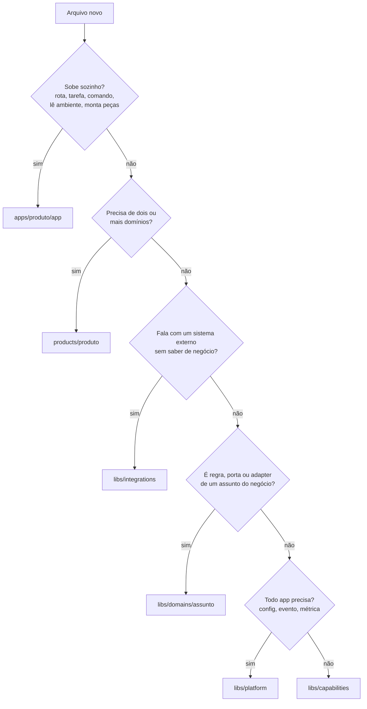
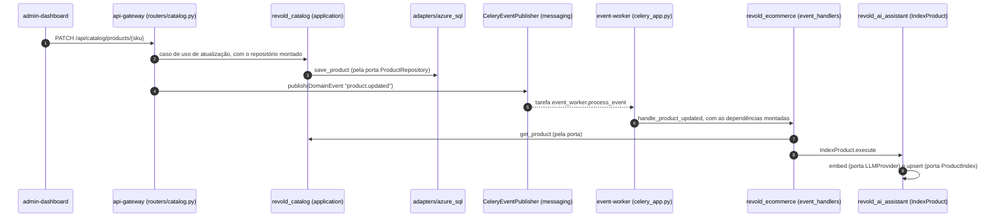

# Aula de onboarding: a arquitetura do monorepo `revold`

> Para quem chega: o que é cada pasta, por que cada regra existe e como mexer sem quebrar. A
> referência curta é [docs/ARQUITETURA.md](../ARQUITETURA.md); o passo a passo de trabalho é o
> [CONTRIBUTING.md](../../CONTRIBUTING.md). As decisões estão nas ADRs
> [0027](../kb/decisoes/0027-estrutura-apps-products-libs.md) a
> [0031](../kb/decisoes/0031-gates-na-maquina-pilha-em-container.md).
>
> Leitura: 30 minutos. Se só tiver cinco, leia as seções 2 e 4.

## Sumário

1. [O problema que a arquitetura resolve](#1-o-problema-que-a-arquitetura-resolve)
2. [A arquitetura em uma página](#2-a-arquitetura-em-uma-página)
3. [Os conceitos, um por um](#3-os-conceitos-um-por-um)
4. [A regra entre unidades (D1)](#4-a-regra-entre-unidades-d1)
5. [A regra dentro de uma unidade: camadas](#5-a-regra-dentro-de-uma-unidade-camadas)
6. [Quem fiscaliza as regras](#6-quem-fiscaliza-as-regras)
7. [Tour pelas unidades de hoje](#7-tour-pelas-unidades-de-hoje)
8. [Uma edição de produto, atravessando o código](#8-uma-edição-de-produto-atravessando-o-código)
9. [Desvios conscientes](#9-desvios-conscientes)
10. [Como contribuir sem quebrar a arquitetura](#10-como-contribuir-sem-quebrar-a-arquitetura)
11. [Versão, release e imagem](#11-versão-release-e-imagem)
12. [Perguntas difíceis, com resposta](#12-perguntas-difíceis-com-resposta)

---

## 1. O problema que a arquitetura resolve

### 1.1 O que existe

Um e-commerce: uma API (FastAPI), dois workers (Celery), uma loja e um painel administrativo
(Next.js), sobre Azure SQL e Redis. A regra de negócio está dividida em dez bounded contexts
(catálogo, carrinho, estoque, pedidos, pagamentos, identidade, notificação, comunicação,
configuração da loja e o assistente de IA), e nenhum deles importa outro
([ADR-0002](../kb/decisoes/0002-separacao-em-cores.md)).

### 1.2 O que estava errado com a estrutura antiga

A separação em contextos era boa e continua. O que não escalava era o que estava em volta dela
(medido na [ADR-0027](../kb/decisoes/0027-estrutura-apps-products-libs.md)):

- **Um pacote Python só**, com uma versão e um conjunto de dependências para tudo. A imagem da API
  instalava o que só o worker usa, e vice-versa.
- **`adapters/` organizado por tecnologia**, não por contexto. O pacote de persistência importava
  oito contextos: mexer no repositório do carrinho exigia instalar o de pagamentos.
- **Dois apps importavam um terceiro** para reusar uma função. Código compartilhado entre apps não
  tinha onde morar.
- **As regras de dependência estavam em texto.** Nenhuma ferramenta conferia.
- **Configuração lida em qualquer lugar.** Dez módulos de adapters liam `os.environ`.

### 1.3 O objetivo

O README do projeto diz que o e-commerce é o primeiro produto de uma base que será reusada. A
arquitetura existe para isso ser verdade: o que é genérico precisa estar **separado** do que é da
loja, com uma fronteira que uma ferramenta confere, e cada app precisa levar para produção só o que
usa.

---

## 2. A arquitetura em uma página

```text
                 apps/ecommerce/
   api-gateway   event-worker   catalog-indexer      storefront   admin-dashboard
        │             │               │                    │            │
        └─────────────┼───────────────┘                    │  (HTTP)    │
                      ▼                                     ▼            │
              products/ecommerce                     libs/web/ui         │
        (o que cruza dois ou mais domínios)                              │
                      │                                                  │
                      ▼                                                  │
                libs/domains/                                            │
   catalog  cart  inventory  orders  payments  identity                  │
   notification  communication  store-settings  ai-assistant             │
                      │   (só pela camada adapters/)                     │
                      ▼                                                  │
              libs/integrations/                                         │
   azure-sql  redis  messaging  prometheus  smtp  whatsapp               │
   mercado-pago  openai  azure-blob                                      │
                      │                                                  │
                      ▼                                                  │
                libs/platform                                            │
        configuration · events · observability                           │
```

Cinco frases:

1. **A seta só desce.** Uma unidade importa as de baixo, nunca as de cima nem as do lado.
2. **Domínio não importa domínio.** O que precisa de dois é do produto.
3. **Só o app lê ambiente e monta adapters.** Lib e produto recebem tudo por parâmetro.
4. **Cada unidade tem um `unit.yaml`**, e é dele que saem as fronteiras, o CODEOWNERS e o fecho.
5. **Os sites não importam Python.** Falam com a API por HTTP.

---

## 3. Os conceitos, um por um

### 3.1 Unidade

Uma pasta com um `unit.yaml`, um `pyproject.toml` (ou `package.json`), um `README.md`, o código em
`src/<pacote>/` e os testes em `tests/`. Tem versão própria e dono. É a menor coisa que o
repositório versiona, testa e atribui a alguém.

```yaml
# libs/domains/catalog/unit.yaml
id: catalog
kind: domain
product:
language: python
lifecycle: pilot
owners: ["@SamuelSMatos", "@dmourans"]
depends_on: ["azure-sql", "azure-blob"]
```

### 3.2 Os tipos de unidade (`kind`)

| Tipo | O que é | Exemplo daqui |
|---|---|---|
| `platform` | o que todo app usa | `revold_platform`: parser de ambiente, evento de domínio, porta de métricas |
| `integration` | cliente de **um** sistema externo, sem regra de negócio | `revold_smtp`, `revold_mercado_pago`, `revold_azure_sql` |
| `capability` | mecanismo técnico reutilizável, sem estado de negócio | nenhuma ainda (seria: gerar PDF, exportar planilha) |
| `domain` | um bounded context, com as regras, as portas e os adapters dele | `revold_catalog`, `revold_cart` |
| `product` | o que é de um produto: o que cruza domínios | `revold_ecommerce` |
| `app` | o que sobe sozinho; o composition root | `api_gateway`, `event_worker` |
| `web` | pacote TypeScript compartilhado | `@revold/ui` |

**Como diferenciar `integration` de `domain`:** a integração sabe falar com o Mercado Pago e não
sabe o que é uma cobrança. O domínio `payments` sabe o que é uma cobrança e não sabe montar uma
requisição HTTP. O adapter do domínio (`adapters/gateways/mercado_pago_gateway.py`) é quem traduz
um no outro.

**Como diferenciar `domain` de `product`:** o domínio conhece um assunto. O produto conhece a
**combinação**: "estoque baixo vira evento" precisa de estoque e de eventos; "reindexar o catálogo
para o assistente" precisa de catálogo e de IA.

### 3.3 App e composition root

O app é o único lugar em que tudo se encontra. Ele lê o ambiente (`settings.py`), escolhe os
adapters (Azure SQL ou fake, SMTP ou log), monta os casos de uso e os expõe: como rota HTTP, como
tarefa Celery ou como comando. Não tem regra de negócio.

### 3.4 Porta (port) e adaptador (adapter)

A **porta** é um contrato (`Protocol`) que o domínio declara: "preciso de alguém que salve um
carrinho". O **adapter** é quem cumpre: `RedisCartRepository`. O caso de uso só conhece a porta, e
por isso roda em teste com um fake em memória, sem Redis.

```python
# libs/domains/cart/src/revold_cart/ports/__init__.py
class CartRepository(Protocol):
    async def get(self, cart_id: str) -> Cart | None: ...
    async def save(self, cart: Cart) -> None: ...
```

### 3.5 Factory e configuração tipada

Quando há mais de um adapter para a mesma porta, o domínio tem uma **factory** que escolhe. Ela
recebe um objeto de configuração e não lê o ambiente:

```python
# no domínio: escolhe, sem saber de onde veio a configuração
settings = LLMSettings(provider="azure-openai", azure_endpoint=..., azure_api_key=...)
llm = build_llm_provider(settings)

# no settings.py do app: o único lugar que lê o ambiente
def llm_settings() -> LLMSettings:
    return LLMSettings.from_mapping(env_snapshot())
```

O `from_mapping` conhece o **nome** das chaves do grupo (os do `.env.example`); quem toca
`os.environ` é só o `env_snapshot()` da plataforma, chamado pelo app.

### 3.6 Módulo puro (`pure_modules`)

Uma integração pode declarar submódulos que não fazem I/O: `revold_whatsapp.click_to_chat` (monta
um link), `revold_mercado_pago.webhook_signature` (confere uma assinatura), `revold_openai.messages`
(um tipo de dado). A camada `application/` de um domínio pode importar esses; o resto da integração
só entra por `adapters/`.

### 3.7 Ciclo de vida (`lifecycle`)

`prototype`, `pilot`, `production`, `deprecated`. Um app `production` não pode depender de uma
unidade `prototype`. Hoje tudo é `pilot`: nada foi publicado.

### 3.8 Fecho, BOM e release

O **fecho** de um app é ele e tudo de que ele depende, direta ou indiretamente. É o que a imagem
instala. O **BOM** é a fotografia do fecho num release: a versão e o sha256 do código de cada
unidade. Detalhe na seção 11.

---

## 4. A regra entre unidades (D1)

### 4.1 A tabela

| A unidade é… | …pode depender de |
|---|---|
| `platform` | `platform` |
| `integration` | `platform` |
| `capability` | `platform`, `capability` |
| `domain` | `platform`, `capability`, `integration` (esta, só pela camada `adapters/`) |
| `product` | `platform`, `capability`, `integration`, `domain` |
| `app` | tudo, menos outro app |
| `web` | `web` |

### 4.2 Por que cada regra existe

- **Integração não depende de domínio.** Se o cliente SMTP conhecesse `Notification`, ele só
  serviria para notificação. Sem conhecer, serve para qualquer e-mail de qualquer produto.
- **Integração não depende de integração.** Quem combina duas é o adapter de um domínio, ou o app.
- **Domínio não depende de domínio.** É a regra que mantém cada contexto testável e substituível
  sozinho. O carrinho recebe o preço por parâmetro; não importa o catálogo.
- **App não depende de app.** Um app é o topo. Se dois apps precisam do mesmo código, ele está no
  lugar errado: é do produto ou de uma lib.
- **A dependência é declarada em dois lugares** (`unit.yaml` e `pyproject.toml`), e o gate reprova
  quando divergem. O primeiro alimenta os contratos; o segundo, a instalação.

### 4.3 O que a regra custa

Passar dado por parâmetro em vez de importar. O checkout monta um `CartSummary` com os itens do
carrinho e entrega ao domínio `communication`, em vez de `communication` importar `Cart`. É mais
uma linha no app, e é ela que deixa os dois contextos independentes.

### 4.4 A árvore de decisão "onde ponho este arquivo?"



**As quatro perguntas** (ADR-0027). Um código vai para `libs/` quando responde "sim" a todas:

1. a API não carrega vocabulário de um produto ou de um cliente?
2. outro produto usaria?
3. dá para testar sozinho?
4. tem dono?

Na dúvida, prefira `libs/` **quando mover depois sairia caro** (a API pública seria quebrada por
todos os consumidores) e o produto **quando a abstração ainda é palpite**. Em geral, começar no
produto e promover depois é o erro mais barato.

Dentro de um domínio, a pergunta seguinte é a camada (seção 5).

---

## 5. A regra dentro de uma unidade: camadas

```text
libs/domains/payments/src/revold_payments/
├── adapters/           fala com o mundo
│   ├── gateways/         fake_gateway.py, mercado_pago_gateway.py, factory.py
│   └── azure_sql/        models.py, repository.py
├── application/        os casos de uso (use_cases.py) e os schemas da API (schemas.py)
├── ports/              os contratos: PaymentGateway, ChargeRepository
└── domain/             a regra pura: Charge, ChargeStatus, Money
```

| Camada | Pode importar | Não pode |
|---|---|---|
| `domain/` | biblioteca padrão | as outras camadas, integração, biblioteca de I/O |
| `ports/` | `domain/` | `application/`, `adapters/`, integração com I/O |
| `application/` | `ports/`, `domain/`, `pure_modules` de integração | `adapters/`, integração com I/O |
| `adapters/` | tudo da unidade, as integrações declaradas, bibliotecas de I/O | |

Três detalhes:

- **O adapter de desenvolvimento mora na mesma camada do real.** `fake_gateway.py` fica ao lado de
  `mercado_pago_gateway.py`. Não existe pasta `testing/` dentro de unidade: o app usa o fake no
  modo local, e produção não deve importar nada chamado "testing". As fábricas de dados de teste
  moram fora de toda unidade, em `tests/support/`.
- **Arquivo fora das quatro camadas é permitido** quando não é nenhuma delas: `seed.py`, no
  catálogo e na configuração da loja, declara o dado de demonstração.
- **O produto tem as mesmas camadas.** Hoje só `application/` tem código.

---

## 6. Quem fiscaliza as regras

Regra escrita não segura nada. Cada regra desta aula tem uma ferramenta:

| Regra | Quem confere | Como se vê quebrada |
|---|---|---|
| tipo, `depends_on`, ciclo | `uv run dev check` (manifesto) | "x (integration) nao pode depender de y (domain) pela regra D1" |
| `unit.yaml` e `pyproject.toml` iguais | `uv run dev check` | "o pyproject.toml pede [...], que faltam no depends_on" |
| import entre unidades | import-linter, gerado | `x so importa o que declara em depends_on BROKEN` |
| ordem das camadas | import-linter, gerado | `x: camadas BROKEN` |
| integração só em `adapters/` | import-linter, gerado | `x: integracao com I/O so entra pela camada adapters BROKEN` |
| gerados em dia | `uv run dev check` | "Gerados fora de dia. Rode `uv run dev gen`" |
| versão que não subiu | `uv run dev check` | "o src/ mudou ... e a versao continua X" |
| ambiente só no `settings.py` | `tests/architecture/test_units.py` | "le variavel de ambiente" |
| app importa só o que declara | `tests/architecture/test_app_imports.py` | "importa unidade fora do depends_on" |
| job do CI ligado ao `CI OK` | `tests/architecture/test_ci_workflow.py` | "jobs fora do `needs` do ci-ok" |
| a imagem leva o que o app importa | job "Imagem" do CI | `ModuleNotFoundError` no passo de import |

O `.importlinter` tem 54 contratos e ninguém os escreve: saem dos `unit.yaml`.

---

## 7. Tour pelas unidades de hoje

Cada unidade tem um `README.md` com o que ela faz e o que ela **não** faz. O resumo:

### 7.1 `libs/platform` — `revold_platform`

`configuration` (o parser de ambiente, o único lugar de `libs/` que toca `os.environ`), `events`
(`DomainEvent`, as portas `EventPublisher` e `WebhookSender`, e os dois adapters sem sistema
externo) e `observability` (a porta `MetricsPublisher`).

### 7.2 `libs/integrations`

| Unidade | Fala com | Quem usa |
|---|---|---|
| `azure-sql` | o banco (engine, sessão, `Base`) | os adapters `azure_sql/` de sete domínios |
| `redis` | o Redis (o cliente) | os apps, que entregam o cliente aos adapters `redis/` |
| `messaging` | a fila (Celery) e endpoints de parceiro (webhook HTTP) | os apps |
| `prometheus` | o Prometheus (contadores e histogramas) | o `api-gateway` |
| `smtp` | um servidor SMTP | `notification` |
| `whatsapp` | a Cloud API da Meta; o link `wa.me` | `notification`, `communication` |
| `mercado-pago` | a API de pagamentos; a assinatura do webhook | `payments` |
| `openai` | Azure OpenAI e endpoints compatíveis | `ai-assistant` |
| `azure-blob` | o Azure Blob Storage | `catalog` |

### 7.3 `libs/domains`

Os dez contextos. Todos têm a mesma forma (seção 5). Diferem nos adapters:

- só Azure SQL: `inventory`, `orders`, `store-settings`;
- só Redis: `cart`;
- Azure SQL e outro provedor: `catalog` (mídia), `payments` (gateway), `ai-assistant` (LLM),
  `identity` (Redis e o provedor de login);
- só provedor externo: `notification` (log, SMTP, WhatsApp), `communication` (WhatsApp).

### 7.4 `products/ecommerce` — `revold_ecommerce`

O que cruza domínios: `stock`, `catalog_indexing`, `event_handlers`, `seed`. E, fora do pacote, os
contratos OpenAPI e as migrações do banco da loja.

### 7.5 `apps/ecommerce`

| App | Runtime | O que expõe |
|---|---|---|
| `api-gateway` | `fastapi-api` | as rotas HTTP, `/metrics`, `/health`, e `python -m api_gateway.seed` |
| `event-worker` | `celery-worker` | a tarefa `event_worker.process_event` |
| `catalog-indexer` | `celery-worker` | a tarefa `catalog_indexer.reindex_catalog` |
| `storefront` | `next-web` | a loja |
| `admin-dashboard` | `next-web` | o painel |

### 7.6 `libs/web`, `tooling`, `deploy`, `tests`

- `libs/web/ui`: os componentes e o renderizador de página por composição.
- `tooling/`: a CLI `uv run dev`. Não é unidade do produto e não entra em imagem.
- `deploy/`: o Terraform do Azure e o provisionamento do Prometheus e do Grafana.
- `tests/architecture/`: os gates da seção 6. `tests/support/`: as fábricas de dados.

---

## 8. Uma edição de produto, atravessando o código

O que acontece quando alguém edita um produto no painel, do clique ao índice do assistente:



O que olhar:

- **Passos 2 e 6:** quem monta os adapters reais é sempre um app (`dependencies.py` na API,
  `celery_app.py` no worker). O caso de uso recebe portas.
- **Passo 4:** a API não chama o worker. Publica um evento com um **nome** e dados primitivos. O
  nome da tarefa é o único acoplamento entre os dois apps, e nenhum importa o outro.
- **Passos 7 e 8:** a reindexação precisa do catálogo **e** do assistente. Por isso é do produto.
  Antes, morava no app `catalog-indexer`, e a API e o worker importavam esse app para usá-la.
- **Passo 9:** o assistente não sabe se o LLM é o de desenvolvimento, a Azure ou o DeepSeek. A
  escolha foi feita no passo 6, com a configuração que o `settings.py` do worker leu.

---

## 9. Desvios conscientes

O que não está como a regra pede, e por quê. O detalhe e o estado de cada um estão na seção 13 do
[CONTRIBUTING.md](../../CONTRIBUTING.md).

- **Regra de negócio dentro de funções de rota.** O checkout, por exemplo, ainda está escrito no
  router do carrinho. Só a orquestração que já estava em módulo próprio foi para o produto.
- **`domain/__init__.py` e `ports/__init__.py` com código.** Cada contexto tinha um `domain.py` e
  um `ports.py`; viraram pacotes com o conteúdo no `__init__.py`, para o import
  (`from revold_cart.domain import Cart`) e o histórico do arquivo não mudarem. Quando um deles
  crescer, quebra-se em módulos dentro do pacote.
- **`schemas.py` (Pydantic) em `application/`.** São o formato da API, espelho dos contratos
  OpenAPI. Estão no domínio porque nasceram lá; o lugar natural, a médio prazo, é o app.
- **Portas satisfeitas sem herança.** `AzureBlobStorage` e `PrometheusMetricsPublisher` estão em
  integrações e não importam a porta que cumprem: `Protocol` é estrutural. O mypy confere o
  encaixe no ponto em que cada um é devolvido como a porta (a factory de mídia do catálogo e o
  `dependencies.py` da API).
- **O nome do cliente piloto em código de lib.** Em mensagens, em comentários e em duas variáveis
  de ambiente.

---

## 10. Como contribuir sem quebrar a arquitetura

### 10.1 Antes de qualquer coisa

Leia o `README.md` da unidade em que vai mexer. Rode `uv run dev check` e `uv run dev test
--affected -q` antes de começar: se já estão vermelhos, o problema não é seu, e é melhor saber
agora.

### 10.2 Caso A: mudar a regra de um contexto

Tudo dentro de `libs/domains/<contexto>/`. Regra em `domain/`, caso de uso em `application/`, teste
em `tests/`. Suba a versão do domínio (`uv run dev bump <contexto> patch`).

### 10.3 Caso B: um adapter novo para uma porta que já existe

Exemplo: outro gateway de pagamento.

1. O cliente do serviço, sem regra de negócio, é uma integração nova:
   `uv run dev new integration <id>`.
2. O adapter, que traduz entre o domínio e o cliente, entra em
   `libs/domains/payments/.../adapters/gateways/`.
3. A factory do domínio ganha o provedor novo, e o `PaymentSettings`, os campos dele.
4. O `depends_on` do domínio ganha a integração, no `unit.yaml` e no `pyproject.toml`.
5. O `.env.example` ganha as variáveis. Nenhum app muda: o `settings.py` já entrega o
   `PaymentSettings` inteiro.
6. Teste em sandbox (`respx`), dizendo no PR o que não foi validado contra o serviço real.

### 10.4 Caso C: algo que precisa de dois contextos

É do produto: `products/ecommerce/src/revold_ecommerce/application/`. A função recebe as portas de
cada contexto por parâmetro e não monta nada. O teste usa fakes.

### 10.5 Caso D: um contexto novo

`uv run dev new domain <id> --depends-on <ids>`. Antes, as quatro perguntas (seção 4.4) e uma ADR:
contexto novo muda a arquitetura.

### 10.6 Caso E: uma tabela nova

O modelo SQLAlchemy em `adapters/azure_sql/models.py` do domínio dono, herdando de
`revold_azure_sql.db.Base`. Se o domínio ainda não tinha tabela, ele entra na lista de
`products/ecommerce/src/revold_ecommerce/adapters/database.py`. A migração sai do
`alembic revision --autogenerate` (CONTRIBUTING, seção 9.3), revisada linha a linha, com `upgrade`
e `downgrade`, em `products/ecommerce/migrations_azure_sql/versions/`, no mesmo PR. O teste
`test_migrations_match_models.py` reprova o PR em que modelo e migração não batem.

### 10.7 Caso F: um app novo, ou um produto novo

`uv run dev new app <produto>/<app> --runtime <fastapi-api|celery-worker>`. Produto novo:
`uv run dev new product <id> --product <id>`, e os apps dele em `apps/<id>/`. Um produto não importa
outro; o que os dois usam sobe para `libs/`.

### 10.8 Checklist de revisão de PR

- [ ] O arquivo está na unidade e na camada certas (árvore 4.4 e tabela da seção 5)?
- [ ] `dev check` verde, sem editar `.importlinter` ou `CODEOWNERS` à mão?
- [ ] Ambiente lido só no `settings.py` do app?
- [ ] Dependência nova nos dois lugares (`unit.yaml` e `pyproject.toml`)?
- [ ] O `src/` mudou? A versão da unidade subiu? (vale depois do primeiro release do app que a usa)
- [ ] Mudou tabela? Migração com `downgrade` no mesmo PR?
- [ ] Adapter real novo tem adapter de desenvolvimento e teste em sandbox?
- [ ] PR pequeno (a `main` é a base de todos)?

### 10.9 Anti-padrões que a revisão deve barrar

| Anti-padrão | Por que é ruim | O certo |
|---|---|---|
| "Vou pôr no `platform`, é genérico" | o `platform` vira depósito | as quatro perguntas e o tipo certo |
| Pasta `utils/`, `common/`, `core/` ou `adapters/` de topo | lugar sem dono atrai tudo | a unidade que usa |
| Ler `os.environ` numa lib ou no produto | o teste depende da máquina; o valor real some do diagnóstico | valor por parâmetro, lido no `settings.py` |
| Importar o cliente de integração em `application/` | a regra fica presa à tecnologia | porta em `ports/`, adapter em `adapters/` |
| Um domínio importando outro "só para um tipo" | os dois passam a mudar juntos | dado por parâmetro, ou a combinação no produto |
| Um app importando outro app | a imagem de um passa a levar o outro | o código compartilhado no produto |
| Regra de negócio numa função de rota ou de tarefa | não tem teste sem subir o app | caso de uso no domínio ou no produto; a rota só chama |
| Dependência só no `pyproject.toml` | funciona na máquina, quebra na imagem ou no gate | `unit.yaml` e `pyproject.toml` |

---

## 11. Versão, release e imagem

O detalhe está em [docs/versionamento-e-deploy.md](../versionamento-e-deploy.md). O essencial:

- **Cada unidade tem a própria versão** (`uv run dev bump <unidade> patch`). Um lock só
  (`uv.lock`), em Python 3.12.
- **O app só sobe de versão no release** (`uv run dev release <app> patch`), que antes roda os
  testes do fecho.
- **O release grava o BOM** (`.releases/<app>.json`): a versão e o sha256 do `src/` de cada
  unidade do fecho, e o sha256 do `uv.lock`.
- **Na `main`**, o `release.yml` confere o BOM contra o código, cria a tag `<app>@<versão>` e monta
  a imagem.
- **A imagem leva só o fecho**: `uv sync --frozen --no-default-groups --package <app>`. A da API
  tem 22 unidades; a do worker de eventos, 15.

---

## 12. Perguntas difíceis, com resposta

**Dez domínios pequenos não são burocracia demais?** Cada um custa quatro arquivos de manifesto. Em
troca, o fecho por app é exato e a regra "domínio não importa domínio" tem onde ser conferida. Se
dois contextos passarem a mudar sempre juntos, o sinal é fundi-los, e isso é uma ADR.

**Por que o produto, se hoje só há um?** Porque já existe código que não é de nenhum contexto. Sem
o produto, esse código morava em apps, e os apps se importavam.

**Por que não deixar a factory ler o ambiente? Era mais curto.** Porque leitura espalhada some do
diagnóstico (não há um lugar que diga o que o app lê) e prende o teste à máquina. Com a
configuração tipada, o teste da factory monta o objeto e não toca em variável de ambiente.

**Um site pode importar um tipo Python?** Não. O contrato entre a API e os sites é o OpenAPI em
`products/ecommerce/contracts/api/`.

**E microsserviço?** As portas já separam quem chama de quem implementa, e o app já isola a
montagem. Extrair um domínio é possível quando houver motivo (escala, time dono, cadência de
deploy). Não é uma meta.

**O que acontece se eu editar o `.importlinter` à mão?** O `dev check` reprova no commit: o arquivo
não bate com o gerado. Mude o `unit.yaml` e rode `uv run dev gen`.

**Como sei se a minha mudança exige release?** `uv run dev release <app> patch --dry-run` mostra o
fecho do app. Se o que você mudou está nele, exige.
