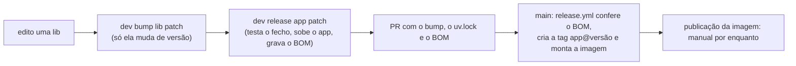
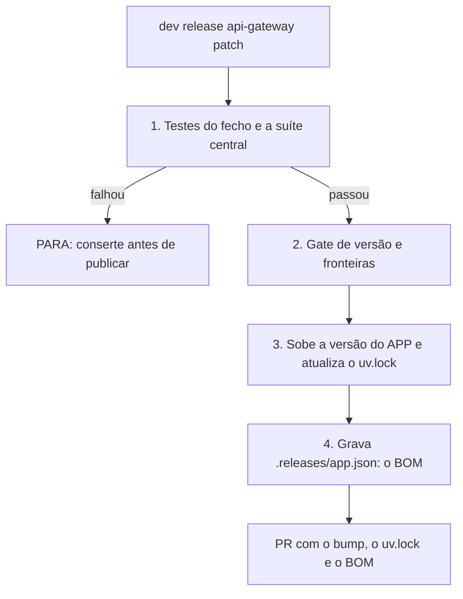

# Versionamento, release e deploy

> Como cada unidade é versionada de forma independente, como um app vira release e o que existe
> (e o que falta) entre o release e o ambiente publicado. Leia antes de mexer em versão ou publicar.
>
> As unidades e as regras entre elas: [ARQUITETURA.md](ARQUITETURA.md). Decisões:
> [ADR-0028](kb/decisoes/0028-trunk-based-e-release-por-app.md) (trunk-based e release por app) e
> [ADR-0029](kb/decisoes/0029-workspace-uv-versao-por-unidade-e-lock-unico.md) (workspace uv,
> versão por unidade, um lock só). O roteiro de quem faz o release: [CONTRIBUTING.md](../CONTRIBUTING.md),
> seção 8.

---

## 1. O modelo em uma frase

**Cada unidade tem a própria versão e sobe sozinha; o app só muda de versão no release, depois de
provar que o conjunto inteiro funciona; e o que o release aprova é o conjunto inteiro, conferido por
hash.**



## 2. Versão independente por unidade

Mexer numa unidade sobe só a versão dela. As outras ficam onde estão.

```bash
uv run dev version                     # a versão de cada unidade Python
uv run dev bump catalog patch          # 0.1.0 -> 0.1.1, só ela
uv run dev bump catalog minor          # 0.1.0 -> 0.2.0
uv run dev bump catalog 1.4.0          # versão explícita
```

O `dev bump` reescreve a versão no `pyproject.toml` da unidade e atualiza o `uv.lock`, que registra
a versão de cada membro do workspace. Os dois vão no mesmo commit.

Isso não quebra ninguém por duas razões:

1. **Dependência interna sem pino.** Uma unidade depende de `"revold-catalog"`, nunca de
   `"revold-catalog==0.1.0"`. No workspace, todo mundo usa a versão que está na árvore.
2. **A dependência só desce** ([ARQUITETURA.md](ARQUITETURA.md), seção 3). Um domínio não é
   importado por outro domínio: o raio de uma mudança é a unidade, quem está acima dela e o app.

**Um lock só.** O monorepo tem um workspace `uv` e um `uv.lock`, em Python 3.12. Por isso as
dependências de terceiros são em faixa, nunca pino exato num membro: todos os membros precisam
continuar co-resolvíveis.

### O gate que impede o mesmo número com outro conteúdo

O `dev check` (hook e CI) reprova quando o `src/` de uma unidade do fecho de um app mudou desde o
último release daquele app e a versão dela não subiu. O ponto de comparação é o BOM do último
release (`.releases/<app>.json`), que guarda o sha256 do `src/` de cada unidade. A mensagem já traz
o comando: `uv run dev bump <unidade> patch`.

O gate não depende do histórico do git: funciona em clone raso e antes do commit. O sha256 é
calculado com o fim de linha normalizado, para a mesma árvore dar o mesmo resultado no Windows
(CRLF no checkout) e no runner do CI (LF).

Enquanto um app não tem release, não há com o que comparar. O gate diz isso a cada rodada e não
reprova (CONTRIBUTING, seção 13).

## 3. O release do app: provar o conjunto

Trocar o número do app não impede o app de quebrar. O que protege é rodar os testes do app contra
as versões novas das unidades **antes** de publicar. Por isso toda publicação passa pelo `release`.

```bash
uv run dev release api-gateway patch --dry-run    # mostra o fecho, o BOM e o que mudaria
uv run dev release api-gateway patch              # faz de verdade
```

O `release` trabalha sobre o **fecho** do app: o app e tudo de que ele depende, calculado pelo
`depends_on` dos `unit.yaml`, com as dependências primeiro. Ninguém lista unidade à mão.



O **BOM** (`.releases/<app>.json`, versionado, e `dist/<app>/<app>.bom.json`) lista, para cada
unidade do fecho, a distribuição, a versão e o **sha256 do `src/`**, na ordem de instalação, mais o
sha256 do `uv.lock`, que trava a versão de cada dependência de terceiro. Um trecho:

```json
{
  "schema": 1,
  "app": "event-worker",
  "versao": "0.2.0",
  "lock_sha256": "…",
  "unidades": [
    { "unidade": "revold-platform", "versao": "0.1.0", "sha256": "…" },
    { "unidade": "event-worker", "versao": "0.2.0", "sha256": "…" }
  ]
}
```

O release pelo tooling cobre os **apps Python**. Os sites ainda ficam de fora (CONTRIBUTING, seção
13).

## 4. Da `main` à tag e ao GitHub Release

Quando o PR com `.releases/<app>.json` entra na `main`, o `.github/workflows/release.yml`:

1. confere o BOM contra o código que entrou (`uv run dev verify-release <app>`) e **reprova** se a
   versão ou o sha256 de alguma unidade, ou o sha256 do `uv.lock`, for diferente do que o PR
   aprovou. Diferença ali é código que não é o do PR: outra mudança entrou na `main` entre o
   `dev release` e o merge, e o release precisa ser refeito a partir da `main` atual;
2. cria a tag `<app>@<versão>`. Só o GitHub Actions cria essas tags: o ruleset `tags-de-release`
   (`scripts/setup-rulesets.sh`) recusa qualquer outra pessoa;
3. publica o GitHub Release com o BOM;
4. monta a imagem do app (`docker build --target runtime`) e, se a publicação estiver ligada, envia
   ao registro.

A tag não é o gatilho, de propósito: tag criada pelo próprio workflow não dispara outro workflow, e
quem cria a tag é ele.

## 5. A imagem

Cada app Python tem o próprio `Dockerfile`, e a imagem leva **só o fecho do app**:

```dockerfile
RUN uv sync --frozen --no-default-groups --package api-gateway
```

O contexto do build é a raiz do monorepo, porque o `uv sync` precisa do workspace inteiro (o
`uv.lock` e o `pyproject.toml` de cada membro). `--frozen` instala exatamente o que o `uv.lock`
diz; `--no-default-groups` deixa de fora pytest, ruff e mypy; `--package` instala o app e o que ele
declara, e nada mais.

É por isso que um app precisa declarar tudo o que importa: no ambiente de desenvolvimento todas as
unidades estão instaladas, e um `import` de uma unidade não declarada funciona na máquina e quebra
na imagem. Dois gates cobrem isso: o teste `tests/architecture/test_app_imports.py` e o job
"Imagem" do CI, que monta a imagem e importa cada módulo do app dentro dela.

```bash
uv run dev build api-gateway            # o BOM do fecho, em dist/api-gateway/
uv run dev build api-gateway --image    # o BOM e a imagem revold/api-gateway:<versão>
make build                              # as cinco imagens de runtime, com a tag local
```

## 6. O ambiente: o que existe e o que falta

O alvo é o Azure Container Apps
([ADR-0004](kb/decisoes/0004-plataforma-de-execucao-azure.md)), descrito em
[deploy/terraform/](../deploy/terraform/README.md).

| Etapa | Estado |
|---|---|
| BOM conferido e tag criada na `main` | automático (`release.yml`) |
| Imagem montada no release | automático (`release.yml`) |
| Imagem enviada ao registro (GHCR) | desligado por padrão; liga com a variável de repositório `IMAGE_PUBLISH_ENABLED=true` |
| Imagem levada ao Azure Container Registry | não existe |
| Container App atualizado com a imagem nova | não existe; o Terraform aponta para uma imagem de exemplo |
| Migração aplicada no banco do ambiente | não existe; hoje só `make migrate`, na pilha local |
| Terraform aplicado | nunca foi aplicado nem validado |

**Promoção, quando o ambiente existir:** a mesma imagem em homologação e em produção. Ambiente é
promoção, não rebuild. As credenciais de cada ambiente moram no ambiente do GitHub (*Settings ->
Environments*), nunca nos segredos do repositório, e produção leva "Required reviewers".

**Migração:** o histórico Alembic está no fecho do produto e sobe junto com a imagem. A ordem
(migração antes ou depois da imagem nova) e o plano de volta são respondidos por escrito no PR de
release (CONTRIBUTING, seção 8.2), porque dependem de a mudança ser compatível com o código antigo.

## 7. Colinha de comandos

| Quero… | Comando |
|---|---|
| Criar uma unidade nova | `uv run dev new <kind> <id> --depends-on <ids>` ([ARQUITETURA.md](ARQUITETURA.md), seção 8) |
| Ver a versão de cada unidade | `uv run dev version` |
| Subir a versão de **uma** unidade | `uv run dev bump <unidade> <patch\|minor\|major\|X.Y.Z>` |
| Ver o que a branch afeta | `uv run dev affected` |
| Rodar os testes (todos ou só os afetados) | `uv run dev test [--affected]` |
| Gate único (manifesto, versões, fronteiras, mypy) | `uv run dev check` |
| Regenerar `.importlinter` e CODEOWNERS | `uv run dev gen` |
| Ver o BOM do fecho de um app | `uv run dev build <app>` (em `dist/<app>/`) |
| Montar a imagem de um app | `uv run dev build <app> --image` |
| Gerar o wheel de uma unidade solta | `uv run dev build <unidade>` |
| Ver o release sem fazer nada | `uv run dev release <app> <parte> --dry-run` |
| Release de um app (com teste) | `uv run dev release <app> <parte>` |
| Conferir um BOM gravado contra o código | `uv run dev verify-release <app>` |

## 8. Erros que este modelo evita

- **Republicar tudo quando mexeu numa unidade:** o `bump` mexe numa só; a versão do app só sobe no
  release.
- **Publicar unidade nova sem provar o app:** o `release` roda os testes do fecho antes de subir o
  app; falhou, para tudo.
- **Mesmo número, outro conteúdo:** o gate de versão no `dev check` e o BOM com sha256.
- **Pino cascateando:** dependências internas sem `==`; um lock só, em faixa.
- **Unidade esquecida na imagem:** o fecho vem do manifesto, e o CI importa o app dentro da imagem.
- **Release aprovado sobre um código, publicado sobre outro:** o `release.yml` confere o BOM contra
  a `main` antes de criar a tag.
